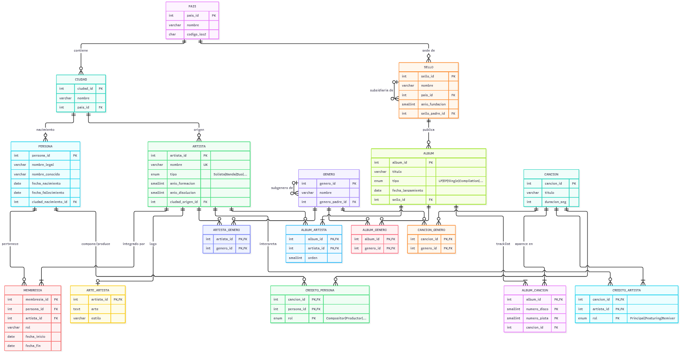

# WikiTunes

CLI en línea, muy estética, para explorar un catálogo musical guardado en MySQL: artistas,
personas, álbumes, canciones, géneros y créditos. No reproduce audio ni tiene usuarios: es un
explorador de información.

Arranca con un conejito con audífonos que escucha música y pregunta **«¿Qué quieres consultar?»**.
Cada consulta cuyo protagonista es un artista abre con su logo en arte ASCII:

```
                 ██ ▄█▀ ██▓ ███▄    █   ▄████
                 ██▄█▒ ▓██▒ ██ ▀█   █  ██▒ ▀█▒
                ▓███▄░ ▒██▒▓██  ▀█ ██▒▒██░▄▄▄░
                ▓██ █▄ ░██░▓██▒  ▐▌██▒░▓█  ██▓
                ▒██▒ █▄░██░▒██░   ▓██░░▒▓███▀▒
 ▄████▄   ██▀███   ██▓ ███▄ ▄███▓  ██████  ▒█████   ███▄    █
▒██▀ ▀█  ▓██ ▒ ██▒▓██▒▓██▒▀█▀ ██▒▒██    ▒ ▒██▒  ██▒ ██ ▀█   █
▒▓█    ▄ ▓██ ░▄█ ▒▒██▒▓██    ▓██░░ ▓██▄   ▒██░  ██▒▓██  ▀█ ██▒
▒▓▓▄ ▄██▒▒██▀▀█▄  ░██░▒██    ▒██   ▒   ██▒▒██   ██░▓██▒  ▐▌██▒
▒ ▓███▀ ░░██▓ ▒██▒░██░▒██▒   ░██▒▒██████▒▒░ ████▓▒░▒██░   ▓██░

            Integrantes de King Crimson el 1 de junio de 1974
╭──────────────┬────────────────────────────────────────────┬───────────╮
│ Integrante   │ Rol                                        │  Periodo  │
├──────────────┼────────────────────────────────────────────┼───────────┤
│ Robert Fripp │ Guitarra, teclados, mellotron, electrónica │ 1968–1974 │
│ Bill Bruford │ Batería, percusión                         │ 1972–1974 │
│ David Cross  │ Violín, viola, flauta, teclados            │ 1972–1974 │
│ John Wetton  │ Bajo, piano, voz principal, violín         │ 1972–1974 │
╰──────────────┴────────────────────────────────────────────┴───────────╯
```

(Fragmento de la salida real; en la terminal el arte de King Crimson se ve en rojo carmesí.)

## Requisitos

- Python 3.12 o superior
- [uv](https://docs.astral.sh/uv/)
- Docker con Docker Compose

## Inicio rápido

```bash
uv sync                      # instala las dependencias
docker compose up -d --wait  # levanta MySQL y carga los datos de la demo
uv run wikitunes             # ¡a explorar!
```

## Uso

```bash
uv run wikitunes                  # arranca con la animación del conejito
uv run wikitunes --sin-animacion  # directo a la portada
uv run wikitunes --version
uv run python -m wikitunes        # equivalente a `uv run wikitunes`
```

La animación dura unos dos segundos y medio y se salta con cualquier tecla. No se muestra si la
salida no es una terminal o si está definida la variable `NO_COLOR`. Para salir, elige «Salir» o
pulsa `Ctrl+C`.

### Consultas

| Consulta | Qué muestra | Encabezado |
|---|---|---|
| Canciones de una persona | En qué canciones participó, por qué vía (banda, solista o crédito propio) y con qué rol | Nombre con pyfiglet |
| Árbol de un género | El género y todos sus subgéneros | Nombre con pyfiglet |
| Tracklist de un álbum | Pistas, intérpretes, duraciones y duración total | Título con pyfiglet |
| Integrantes de un artista en una fecha | Quiénes eran integrantes ese día (`AAAA-MM-DD`) | Arte ASCII del artista |
| Historial de integrantes | Todos los periodos de membresía | Arte ASCII del artista |

### Fichas

| Ficha | Qué muestra |
|---|---|
| Artista | Arte ASCII, tipo, años, origen, géneros, discografía e historial de integrantes |
| Persona | Nombre legal, nacimiento, fallecimiento y artistas de los que fue integrante |
| Canción | Intérpretes, duración, géneros, créditos (compositores, productores...) y álbumes donde aparece |
| Género | Su árbol y los artistas y álbumes del género o de sus subgéneros (desde «Árbol de un género») |

### Navegación

Después de cada resultado, el menú **«¿Y ahora?»** permite seguir navegando: de una canción a su
álbum, de un integrante a sus otras bandas, de un género a sus artistas, del tracklist a una canción
y de ahí a otro álbum donde aparece. «Volver» regresa a la pantalla anterior, y la línea gris
`Menú › Paul McCartney › Wings` muestra el camino recorrido.

Para elegir personas, artistas, álbumes, canciones o géneros no hace falta escribir ids: se escribe
parte del nombre y el autocompletado sugiere opciones (sin importar mayúsculas, tildes ni comillas
tipográficas, así «maxwells» encuentra «Maxwell’s Silver Hammer»). `Tab` muestra las sugerencias.

### Ideas para probar

- **Integrantes de The Beatles** el `1961-06-01` (con Pete Best y Stuart Sutcliffe) y el
  `1963-01-01` (los cuatro).
- **Integrantes de King Crimson** en `1969-06-01`, `1974-06-01`, `1981-06-01` y `1995-06-01`: cuatro
  formaciones distintas.
- **Canciones de Paul McCartney:** vía The Beatles, Wings y en solitario.
- **Tracklist de *1*** (2000): la compilación reutiliza *Something* y *Come Together* de
  *Abbey Road*.
- **Árbol de Rock:** tres niveles (Rock › Rock progresivo › Metal progresivo).

## Base de datos

La base `musica` corre en un contenedor MySQL 8.4. Al arrancar por primera vez se ejecutan el
esquema (`Diagrama/musica_schema_mysql.sql`) y los procedimientos
(`procedimientos_almacenados/musica_procedimientos_mysql.sql`), y se crea un usuario de solo
lectura para la aplicación.

```bash
docker compose up -d --wait     # levantar la base (espera a que esté lista y cargada)
docker compose down             # detenerla (conserva el volumen)
docker compose down -v          # detenerla y borrar el volumen (reinicializa en el próximo arranque)
```

Después de cambiar el esquema o los procedimientos, reinicializa la base con `docker compose down -v`
seguido de `docker compose up -d --wait`.

### Datos de la demo

Cada `docker compose up -d --wait` vuelve a cargar los datos de [`datos/`](datos/) (servicio
`cargador`): reemplaza todo el contenido de la base por el de los CSV en una sola transacción. Si un
CSV tiene un error, el comando falla y la base no cambia; el detalle está en
`docker compose logs cargador`.

También se puede cargar a mano desde el host:

```bash
uv run python -m wikitunes.cargador
```

El formato de los archivos está en [`datos/README.md`](datos/README.md).

La demo gira en torno a dos casos:

- **The Beatles** (incluidos Pete Best y Stuart Sutcliffe) y los proyectos en solitario de sus
  integrantes: John Lennon y la Plastic Ono Band, Paul McCartney y Wings, George Harrison y los
  Traveling Wilburys, y Ringo Starr. Incluye 12 lanzamientos completos (LP, EP, sencillos y la
  compilación *1*), con Billy Preston como invitado.
- **King Crimson**, con sus 23 integrantes y 37 periodos de membresía entre 1968 y 2021, y cuatro
  lanzamientos completos.

### Configuración

La conexión se configura con variables de entorno o con un archivo `.env` (no versionado). Si no
existe, se usan los valores por defecto de desarrollo:

```bash
cp .env.ejemplo .env    # opcional, para cambiar puertos o credenciales
```

| Variable | Por defecto | Uso |
|---|---|---|
| `WIKITUNES_BD_HOST` | `127.0.0.1` | Host de MySQL |
| `WIKITUNES_BD_PUERTO` | `3306` | Puerto publicado en el host |
| `WIKITUNES_BD_NOMBRE` | `musica` | Base de datos |
| `WIKITUNES_BD_USUARIO` | `wikitunes` | Usuario de solo lectura (`SELECT`, `EXECUTE`) |
| `WIKITUNES_BD_CLAVE` | `wikitunes` | Clave del usuario de solo lectura |
| `WIKITUNES_BD_CLAVE_ROOT` | `raiz_wikitunes` | Clave de `root` del contenedor (la usa el cargador) |

## Modelo de datos



17 tablas, 4 triggers, la vista `v_participacion_persona` y 5 procedimientos almacenados. La
persona es la unidad atómica; un artista (banda o solista) agrupa personas mediante `membresia`. La
fuente del diagrama es [`Diagrama/musica_er.mmd`](Diagrama/musica_er.mmd). Después de editarla,
regenera la imagen (usa Docker, no hace falta instalar Node):

```bash
./scripts/generar_diagrama.sh
```

| Procedimiento | Qué hace |
|---|---|
| `sp_canciones_de_persona(nombre)` | Participaciones de una persona (nombre exacto) vía artista o crédito propio |
| `sp_subgeneros(genero)` | El género y todos sus subgéneros, con nivel y ruta |
| `sp_tracklist(album_id)` | Pistas con intérpretes y duración, más un resumen con la duración total (dos resultados) |
| `sp_integrantes_en_fecha(artista, fecha)` | Integrantes de un artista en una fecha |
| `sp_historial_integrantes(artista)` | Todos los periodos de membresía de un artista |

## Procedencia de los datos

Ningún dato es inventado. Las duraciones, los tracklists y las fechas salen de **MusicBrainz** (las
respuestas están guardadas en `obtencion_datos/crudo/`). Las membresías, las biografías, los
créditos y los géneros salen de **Wikipedia**, citados con enlaces a la revisión exacta consultada.
Cada dato tiene su fuente en [`obtencion_datos/fuentes.csv`](obtencion_datos/fuentes.csv), y la
metodología y las convenciones están en [`obtencion_datos/`](obtencion_datos/).

```bash
# Borrador del tracklist de Abbey Road, desde la respuesta guardada (sin red)
uv run python obtencion_datos/scripts/musicbrainz.py d6010be3-98f8-422c-a6c9-787e2e491e58
# Regenera el arte ASCII de los artistas
uv run python obtencion_datos/scripts/generar_arte.py
```

## Arquitectura

```
 +--------------------------------+
 |  ui/  (Rich + questionary)     |  arranque, menú, consultas, fichas, navegación
 +---------------+----------------+
                 |
 +---------------v----------------+
 |  catalogo.py  (dataclasses)    |  procedimientos, fichas y listados
 +---------------+----------------+
                 |
 +---------------v----------------+
 |  conexion.py  (mysql-connector)|  CALL + nextset(), errores en español
 +---------------+----------------+
                 |
        MySQL 8.4 (Docker Compose)  <---  cargador.py  <---  datos/*.csv + datos/arte/*.txt
```

```
src/wikitunes/
  cli.py            punto de entrada (`wikitunes`)
  configuracion.py  variables WIKITUNES_BD_* y .env
  conexion.py       conexión, consultas y procedimientos; errores en español
  catalogo.py       consultas del catálogo (devuelve dataclasses)
  modelos.py        dataclasses
  formato.py        duraciones y periodos
  cargador.py       carga de los CSV y del arte
  ui/
    arranque.py     animación del conejito y portada
    menu.py         menú «¿Qué quieres consultar?»
    preguntas.py    autocompletado normalizado y fechas
    encabezados.py  arte del artista o título con pyfiglet
    consultas.py    render de las consultas
    fichas.py       render de las fichas
    navegacion.py   pantallas, «¿Y ahora?», volver y migas
    acciones.py     acciones del menú principal
    textos.py       traducciones y fechas en español
```

## Decisiones principales

- **Participación vía artista:** una persona participó en una canción vía un artista si ese artista
  está acreditado y la persona, que fue integrante, tiene un crédito propio en la canción **o** era
  integrante en su fecha de salida (la del primer álbum que la contiene). «Vía banda» significa «era
  integrante cuando salió la canción», no necesariamente «tocó en ella».
- **Fin de The Beatles:** las cuatro membresías terminan el 1970-04-10 (anuncio de la separación).
  Por eso, en las pistas del LP *Let It Be* (mayo de 1970) y en las que solo están en *1* (2000), la
  participación sale solo de los créditos.
- **Regla de versiones:** la misma grabación es la misma canción aunque esté remasterizada; una
  mezcla o edición distinta (*Get Back* de single y de LP) es otra canción con el mismo título.
- **Búsqueda exacta e índices:** `sp_canciones_de_persona` busca por nombre exacto (con índices en
  los nombres de persona) y `artista.nombre` es único.
- **Arte ASCII:** se guarda en la tabla `arte_artista`; los títulos que no son de artistas se generan
  con pyfiglet.
- **Solo lectura:** la aplicación usa un usuario con `SELECT` y `EXECUTE`; solo el cargador escribe.

El roadmap completo, con todas las decisiones, está en
[`openspec/roadmap.md`](openspec/roadmap.md), y las especificaciones en
[`openspec/specs/`](openspec/specs/).

## Pruebas y lint

```bash
docker compose up -d --wait && uv run pytest
uv run ruff check . && uv run ruff format --check .
```

Las pruebas marcadas como `integracion` necesitan la base. Si no está levantada, se saltan con un
aviso; con `WIKITUNES_EXIGIR_BD=1` (como en la CI) fallan. La CI de GitHub Actions corre el lint y
todas las pruebas en Python 3.12 y 3.14.
